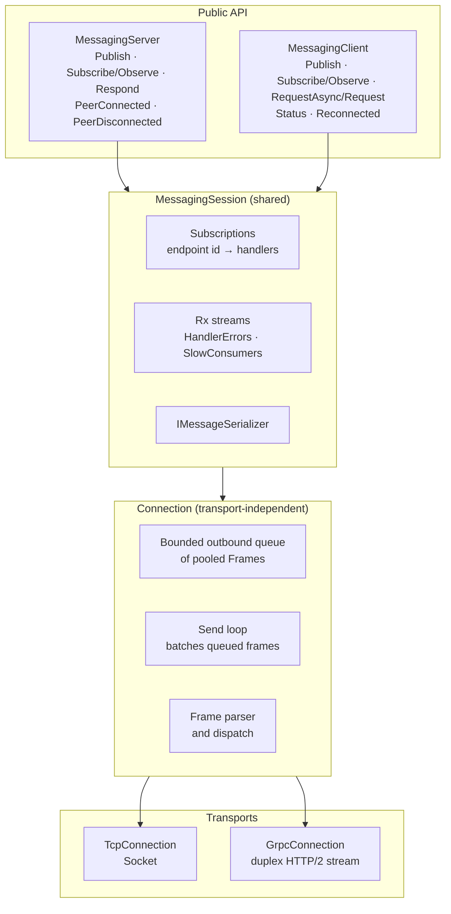
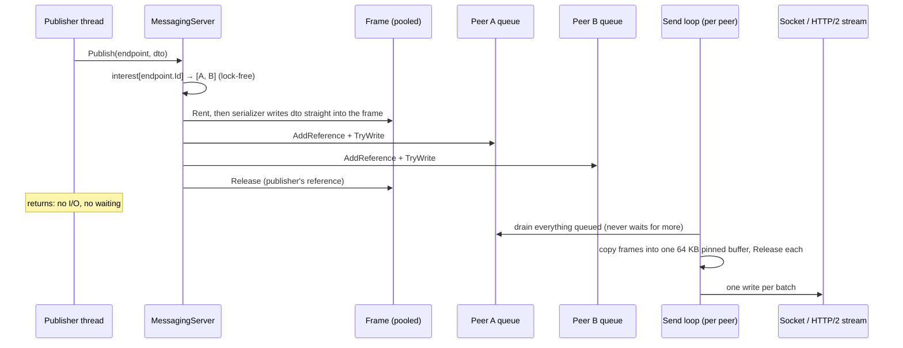
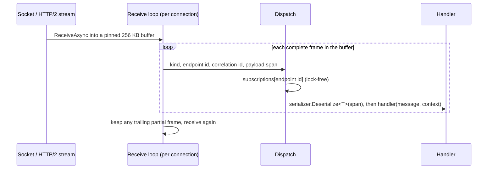
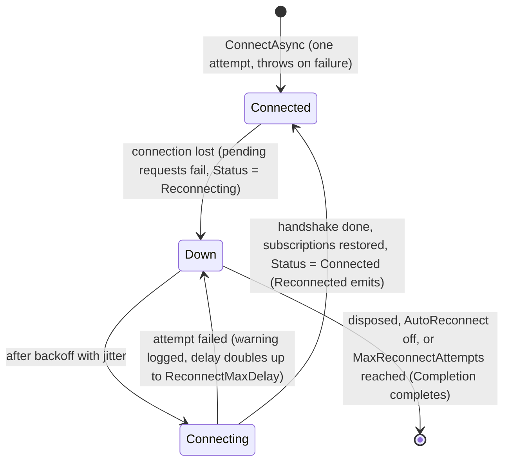

# Light.Messaging architecture

This document explains how Light.Messaging is put together and why. It is for engineers who will maintain the
library, tune it, or add a transport. For usage and benchmark results, see the [Lab README](../README.md).

- [Layers](#layers)
- [Send path](#send-path)
- [Receive path](#receive-path)
- [Threading model](#threading-model)
- [Reactive Extensions](#reactive-extensions)
- [Request/response](#requestresponse)
- [Wire protocol](#wire-protocol)
- [Connection lifecycle](#connection-lifecycle)
- [Slow consumers and flow control](#slow-consumers-and-flow-control)
- [Transports](#transports)
- [Tuning](#tuning)
- [Adding a transport](#adding-a-transport)
- [Next steps](#next-steps)

## Layers



- **`MessagingServer` / `MessagingClient`** hold the routing tables. The server has three: endpoint → subscribed
  peers, endpoint → responder, and the list of peers. The client has its pending requests.
- **`MessagingSession`** holds local subscriptions, dispatches received publishes to them, and turns them into Rx
  streams on request. It also runs the watchdog, which closes connections whose writes have stalled and reports
  slow consumers.
- **`Connection`** does everything that doesn't depend on the transport:
  - the outbound queue and the batching send loop
  - frame parsing
  - the Hello/Goodbye handshakes
  - closing
- **Transport subclasses** only implement `SendAsync`, `ReceiveLoopAsync`, `CompleteSendAsync` and `AbortTransport`.

All routing tables are **copy-on-write**: writers (subscribe, connect, disconnect) build a new dictionary or array
under a lock and publish it with `Volatile.Write`. The hot path (publish, dispatch, request handling) does a single
lock-free read. Subscription changes are rare and messages are not, so this trade suits trading traffic.

## Send path



1. **Nobody subscribed means no work.** If no peer has subscribed to the endpoint, `Publish` returns before
   serializing anything.
2. **Serialize once.** `Frame` implements `IBufferWriter<byte>`, so protobuf-net writes the message straight after
   the header in a pooled buffer. There is no `MemoryStream`, no `ToArray` and no envelope object.
3. **Share by reference.** The same frame is queued to every subscriber with a reference count. The last `Release`
   returns it to the pool. Pooled frames keep buffers of up to 4 KB; larger buffers go back to `ArrayPool`.
4. **Enqueue only.** Each peer has a `FrameQueue`: many writers, one reader, first in first out. It wakes the send
   loop through a reusable `IValueTaskSource`, with continuations on the thread pool, so a send loop never runs on
   the publisher's thread. `Publish` therefore never touches the network and never waits on a slow peer. Only
   Publish frames count towards the capacity and only they can be dropped (see
   [Slow consumers](#slow-consumers-and-flow-control)). That is why this is a custom queue rather than a bounded
   `Channel`, which would drop the oldest item of any kind. In a microbenchmark, both handle about 16–22M
   enqueue/dequeue pairs a second.
5. **Opportunistic batching.** The send loop takes everything already queued and copies it into one pinned 64 KB
   buffer (`SendBatchBytes`), then writes it in one call: one syscall for TCP, one gRPC message for gRPC. It never
   waits for more frames, so a single message goes out alone and immediately, and a burst goes out in large writes.
   A frame larger than the buffer is sent from its own buffer.
6. **Nagle is off** (`NoDelay`). Batching is the send loop's job, so the kernel has no reason to hold small writes
   back.

## Receive path



- **One receive usually delivers many frames.** They are parsed and deserialized straight from the receive buffer
  (`ReadOnlySpan<byte>`), with no copy per message. Only a trailing partial frame is ever moved, to the front of the
  buffer.
- **Large frames.** A frame larger than the receive buffer temporarily gets a pooled buffer of its own.
  `MaxFrameBytes` (default 16 MB) bounds this and rejects corrupt length prefixes.
- **Dispatch is one dictionary lookup on the endpoint id.** There is no global lock, and no filter is evaluated per
  subscription.
- **Handler isolation.** A handler that throws is reported on `HandlerErrors`. Other handlers and the connection keep
  going.
- **gRPC.** Each gRPC message carries whole frames, so the same parser runs over each message's bytes. Batches arrive
  in `ArrayPool` buffers, which are returned once the batch has been processed.

## Threading model

| Code | Runs on | Guarantees |
|---|---|---|
| `Publish`, `RequestAsync` | Caller's thread | Thread-safe and non-blocking. Messages from one thread to one peer keep their order. |
| Send loop | Thread pool, one per connection | The only writer to its transport. |
| Receive loop, `Subscribe` handlers, sync `Respond` handlers | Thread pool, one per connection | Frames from one peer are handled in order, one at a time. Different peers run concurrently. |
| `Observe` / `ObserveWithSender` observers | The receive loop | As above, and OnNext calls never overlap, even across peers (the server synchronizes the observer). |
| `RespondAsync` continuations | Wherever the awaited work completes | The receive loop doesn't wait for them; responses can complete out of order. |
| `RequestAsync` continuation | Thread pool | Never the receive loop, so a slow continuation can't stall reading. |
| `PeerConnected`, `PeerDisconnected`, `Status` (Reconnecting, Closed) | The connection's receive loop or close path | Keep subscribers short. |
| `Reconnected`, `Status` (Connected) | The client's reconnect task, after subscriptions are restored | Safe to send requests from, for example to fetch a snapshot. |
| `SlowConsumers`, request timeouts, backoff | `MessagingOptions.Scheduler` (the thread pool by default) | |

The rule of thumb: **anything slow in a handler slows only that peer's messages.** If a handler must do real work,
hand it to your own queue or worker, or use Rx's `ObserveOn` to move it to another scheduler.

## Reactive Extensions

Rx is the surface for composition and lifecycle. It is not the transport plumbing. The per-message path in
`Connection` and `DispatchPublish` uses plain delegates, so a message costs no operator chain, subject or lock
unless the application asks for one. That is the main difference from Dcs.Messaging, which routes every message
through a synchronized subject and a `Where` filter per subscription.

How each piece is built:

- **`Observe<T>`** is `Observable.Create` over the delegate `Subscribe`, followed by `TakeUntil(stopped)`:
  - Subscribing an observer registers a subscription, and on the client sends Subscribe to the server.
  - Disposing it unregisters, and Unsubscribe goes out when it was the last one.
  - The stream completes when the session is disposed.
  - On a server, the observer is wrapped in `Observer.Synchronize`, because several receive loops can deliver at once
    and Rx forbids overlapping OnNext calls. The client has a single receive loop and needs no wrapper.
- **Lifecycle streams** are subjects:
  - `PeerConnected`, `PeerDisconnected`, `HandlerErrors` and `SlowConsumers` use `Subject.Synchronize`, since they are
    raised from many threads.
  - `Status` is a `BehaviorSubject`, so a new subscriber gets the current state first. `Reconnected` is derived from
    it: `Status.Skip(1).Where(Connected).Select(Server)`.
  - Every stream completes on dispose.
  - An exception thrown by a user's subscriber is caught and reported on `HandlerErrors`, so it can never escape into
    a receive loop and close a connection.
- **Logging subscribes to these streams** like any other consumer, so there is one source of truth for what happened.
- **`Request<TRequest, TResponse>`** is `Observable.FromAsync` over `RequestAsync`. It is cold, so every subscription
  sends, which is what makes `Retry` and `Timeout` behave correctly. It allocates a `Task` per request; hot paths use
  `RequestAsync`.
- **Time** comes from `MessagingOptions.Scheduler`:
  - the watchdog is `Observable.Interval(period, scheduler)`
  - request timeouts are an interval checking deadlines measured on `scheduler.Now`
  - reconnect backoff awaits `Observable.Timer(delay, scheduler)`

  With a `TestScheduler`, tests advance virtual time to trigger timeouts or watchdog reports deterministically (see
  `ReactiveTests`). Send-stall detection measures real elapsed time with `Stopwatch`, because it is about real I/O.

## Request/response

```mermaid
sequenceDiagram
    participant C as MessagingClient
    participant P as Pending requests
    participant S as MessagingServer
    participant R as Responder
    C->>P: id = Interlocked.Increment; register pooled PendingRequest<T>
    C->>S: Request frame (endpoint id, correlation id, payload)
    S->>R: responders[endpoint id] → handler(request, context)
    R->>S: Response frame (same correlation id), queued to the requesting peer only
    S->>C: Response
    C->>P: TryRemove(id), deserialize, complete the ValueTask (continuation on the thread pool)
```

- **Correlation ids** are a per-client 64-bit counter. There are no GUID strings.
- **Pooled `IValueTaskSource`.** Each request is completed through a pooled `IValueTaskSource<T>`
  (`ManualResetValueTaskSourceCore`), so steady-state requests allocate no `Task` or `TaskCompletionSource`.
- **Timeouts.** One `Observable.Interval` per client, on the scheduler, checks pending requests every 10 ms against
  deadlines taken from `scheduler.Now`. That avoids a timer or `CancellationTokenSource` per request, at the cost of
  up to 10 ms of slack in when a timeout fires.
- **Errors.** A responder that throws produces an `ErrorResponse` frame carrying the message. The client gets
  `RemoteException`, and the server reports the exception on `HandlerErrors`. A request to an endpoint with no responder also gets an
  `ErrorResponse`, so it fails fast rather than timing out.
- **Close.** When the connection closes, every pending request fails with `MessagingException`.
- **`RespondAsync`.** A handler that completes synchronously takes the same path as `Respond`. Otherwise the response
  is sent from its continuation, and the receive loop moves on to the next frame.

## Wire protocol

All integers are little-endian. TCP and gRPC carry exactly the same frames.

```
uint32  bodyLength      bytes that follow this field
uint8   kind            see below
int32   endpointId      Endpoint.Id (0 for Hello and Goodbye)
int64   correlationId   only for Request, Response and ErrorResponse
bytes   payload
```

| Kind | Value | Direction | Payload |
|---|---:|---|---|
| Hello | 1 | both, first frame | `uint16` protocol version (1), then the UTF-8 session name |
| Publish | 2 | both | Serialized message |
| Request | 3 | client → server | Serialized request |
| Response | 4 | server → client | Serialized response |
| ErrorResponse | 5 | server → client | UTF-8 error message (up to 4096 characters) |
| Subscribe | 6 | client → server | None. Starts delivery of the endpoint to this client. |
| Unsubscribe | 7 | client → server | None |
| Goodbye | 8 | both, last frame | UTF-8 close reason |

- **Header size.** A publish costs 9 bytes of header; a request or response costs 17.
- **Endpoint ids** are FNV-1a over the UTF-8 address. Every process derives the same id with no registration
  exchange. `Endpoint` throws if two addresses collide within a process. Declare endpoints in one shared contracts
  assembly so that collisions show up there.
- **On gRPC**, the service is `light.messaging.Transport/Connect`, a duplex-streaming method defined with a
  hand-written `Method<,>` and a byte marshaller. There is no protoc and no protobuf wrapper. Each gRPC message
  carries one or more whole frames.

## Connection lifecycle

```mermaid
stateDiagram-v2
    [*] --> Handshaking: connected; both sides send Hello
    Handshaking --> Open: peer Hello accepted (version checked)
    Handshaking --> Closed: bad Hello or timeout
    Open --> Draining: Shutdown(reason), local or on receiving Goodbye
    Draining --> Closed: Goodbye exchanged and both streams ended
    Open --> Closed: Close(reason), e.g. error, slow consumer, stall
    Closed --> [*]
```



**Graceful close.** Disposing a server or client calls `Shutdown`, which works like this:

1. The closing side queues `Goodbye` after its last frame, sends everything queued, and ends its stream: TCP
   half-closes, and a gRPC client completes its request stream.
2. On `Goodbye`, the other side does the same: it drains its queue, sends `Goodbye` back, and ends its stream.
3. Each side tears down only after the peer's stream has ended, so every frame sent before `Goodbye` has been
   received.

A naive close loses data. A TCP socket closed while it still has unread input sends a reset. A gRPC stream ended
while HTTP/2 flow control is still holding back data discards that data. The tests
`ServerShutdownDeliversQueuedMessagesFirst` and `ClientDisposeDeliversQueuedMessagesFirst` check the handshake on
both transports.

**Abrupt close.** `Close(reason)` happens on an error, on the slow-consumer policy, or on a stalled send. It discards
the queue, cancels both loops, and aborts the transport: it disposes the socket or resets the HTTP/2 stream. The first
reason recorded wins and is exposed as `Peer.CloseReason`.

**Dead-peer detection:**

| Mechanism | Default | Catches |
|---|---|---|
| TCP keep-alive (`TcpSocketOptions.KeepAliveIdle`) | 10 s idle, then 3 probes 1 s apart | An idle peer that vanished |
| HTTP/2 PINGs (`KeepAlivePingDelay`) | 10 s | The same, for gRPC |
| Send-stall watchdog (`SendStallTimeout`) | 5 s | A peer that is connected but has stopped reading |

### Automatic reconnect (client)



- **One supervisor task per client.** It runs each connection until it closes, then reconnects. The delay starts at
  `ReconnectMinDelay` (100 ms) and doubles after each failure up to `ReconnectMaxDelay` (5 s). It carries ±20%
  jitter, so many clients don't stampede a restarted server.
- **Subscriptions live in the session, not in the connection, so they survive.** On reconnect, the new connection is
  swapped in and a Subscribe frame is queued for every subscribed endpoint, both under the subscription lock. A
  `Subscribe` or `Dispose` that races with the reconnect is therefore never lost or duplicated.
- **Fail fast while down.** `Publish` and `RequestAsync` throw `MessagingException` ("Not connected, reconnecting")
  instead of queueing: an order delivered minutes late is worse than one rejected.
- **In-flight requests fail** with `MessagingException` when the connection drops. Resending is left to the caller,
  because the server may already have acted on them.
- **No replay.** Messages the server published during the outage are lost. `Reconnected` is the hook for
  recovering state, such as requesting a snapshot.
- **The first `ConnectAsync` makes a single attempt**, so a wrong address or a server that isn't running fails
  loudly at startup.
- **Logging.** Each loss is a warning, each failed attempt is a warning with the reason and the next delay, and each
  success is an information entry with the attempt count and the number of subscriptions restored.

## Slow consumers and flow control

Every peer has its own queue (`SendQueueCapacity`, default 65,536 published messages) and its own send loop. A slow
peer can therefore fill only its own queue. The publisher and the other peers are never held up. When the queue is
full of published messages, `SlowConsumerPolicy` decides:

| Policy | Effect | Use for |
|---|---|---|
| `DropOldest` (default) | Discard the oldest queued published message to make room | Prices and other state that newer messages supersede |
| `Disconnect` | Close the connection with reason "send queue full" | Orders, executions, anything where a silent gap is unacceptable |
| `DropNewest` | Discard the message being published | Rarely the right choice; provided for completeness |

**Only Publish frames are ever dropped.** Responses, error responses, requests and control frames (Hello, Goodbye,
Subscribe, Unsubscribe) don't count towards the capacity and are always queued, even past it. Dropping one would
break the protocol: a request would time out for no visible reason, or a subscription would silently never start.
These frames are rare compared with publishes, and the send-stall watchdog closes a peer that stops reading
altogether, so the overflow stays small. When the oldest publish sits behind such a frame, it is removed from the
middle of the queue, and the order of everything else is kept.

**Every drop is counted, and reported as one warning per peer per watchdog check** (about once a second), never one
log entry per message. The count, the running total and the endpoint are read by the watchdog, off the publishing
path. A drop just before a disconnect is reported on close. A typical entry:

```
warn: Light.Messaging[0] Slow consumer lab-client-4242 (127.0.0.1:58021): dropped 48213 message(s) since the last report (112730 in total), most recently on endpoint Lab/Prices. Its send queue of 65536 messages is full: the consumer or the network is not keeping up
```

Each report is also published on the `SlowConsumers` stream as a `SlowConsumerReport` (peer, dropped, total,
endpoint), for metrics and alerting; the warning above is just the logger's subscription to it. `Peer.DroppedFrames`
exposes the running total.

A publisher that would rather slow down than lose a consumer can watch `Peer.QueuedFrames` and back off. The demo
server's benchmark keeps each peer below 32,768 queued frames this way, which is why its streaming latency figures
include up to that many frames of queueing.

## Transports

| | TCP | gRPC |
|---|---|---|
| Stack | `Socket`, `NoDelay`, pinned buffers | Kestrel (HTTP/2, h2c) and `SocketsHttpHandler` |
| Unit of write | One syscall per batch | One gRPC message per batch |
| Extra per-batch cost | None | HTTP/2 DATA frame, gRPC message header, one copy into gRPC's buffer, and one copy out on receive |
| Measured round trip p50 (same host) | 57 µs | 128 µs |
| Choose when | Lowest latency matters, and the network is yours | You need HTTP/2 infrastructure (proxies, load balancers, service mesh) or might later need TLS |

Batching amortizes most of gRPC's per-message cost, which is why its streaming throughput is close to TCP's. Its
per-request latency stays about twice TCP's.

## Tuning

| Setting | Default | Raise it when | Lower it when |
|---|---|---|---|
| `SendQueueCapacity` | 65,536 frames | Bursts are legitimately larger than this | You want slow consumers detected sooner, or less staleness under `DropOldest` |
| `SendBatchBytes` | 64 KB | Throughput over latency, on fast links | Rarely worth it; batches only form when frames are already waiting |
| `MaxFrameBytes` | 16 MB | You send larger messages | You want tighter protection against bad input |
| `TcpSocketOptions.ReceiveBufferBytes` | 256 KB | Very high message rates | Memory per connection matters (thousands of clients) |
| `TcpSocketOptions.SocketSend/ReceiveBufferBytes` | OS default | High-bandwidth, high-latency links | A slow consumer should be detected before megabytes sit in kernel buffers |
| `SendStallTimeout` | 5 s | Peers do long GC pauses | Dead peers must be detected faster |
| `ReconnectMinDelay` / `ReconnectMaxDelay` | 100 ms / 5 s | Many clients share one server, to spread out a reconnect storm | A fast recovery matters more than server load |
| `MaxReconnectAttempts` | 0 (no limit) | | The process should give up and let a supervisor restart it |
| `Scheduler` | `Scheduler.Default` | | Tests: pass a `TestScheduler` to drive timeouts, backoff and the watchdog in virtual time |

`Logger` takes any `ILogger`. Nothing is logged per message, so a real logging pipeline costs nothing on the hot
path.

Beyond the library:

- **Process.** For servers, use `<ServerGarbageCollector>true</ServerGarbageCollector>` and
  `<ConcurrentGarbageCollection>false</ConcurrentGarbageCollection>`. Keep allocations out of your own handlers.
- **Messages.** Prefer numeric ids to strings in hot DTOs. Deserializing strings is most of the per-message cost
  that remains: both transports stream at about 3–3.5M msg/s on the same machine, which points at protobuf
  deserialization rather than the transport.
- **Machine.** Pin latency-critical processes to cores, disable CPU power saving, and use a NIC with receive-side
  scaling configured.

## Adding a transport

1. Subclass `Connection` (internal) and implement the transport hooks:

   | Member | Contract |
   |---|---|
   | `SendAsync(ReadOnlyMemory<byte>, CancellationToken)` | Write whole frames. Only the send loop calls it. |
   | `ReceiveLoopAsync(CancellationToken)` | Read until the peer ends its stream, passing bytes to `ProcessFrames`. On a stream transport, keep any partial frame `ProcessFrames` didn't consume. |
   | `CompleteSendAsync()` | End the outbound stream after a graceful drain. |
   | `AbortTransport()` | Make pending I/O fail. After a graceful drain (`IsClosingGracefully`), close cleanly instead of resetting. |

2. Subclass `ServerTransport` and pass each accepted connection to `IConnectionHost.RunConnectionAsync`. Subclass
   `ClientTransport` and return a connected `Connection` from `ConnectAsync`.
3. Run `Light.Messaging.Tests` against it. Every test is a theory over the transports, so add yours to `Transport`
   and `Harness`.

These base types are internal, so a transport lives either in `Light.Messaging` or in an assembly granted
`InternalsVisibleTo`, as `Light.Messaging.Grpc` is.

## Next steps

These are deliberately left out of the bare-bones version, roughly in order of value for a trading system:

1. **Sequence numbers with gap detection, plus snapshot or replay after a reconnect**, so a client knows exactly
   what it missed during an outage or a slow-consumer drop.
2. **Per-endpoint slow-consumer policy and conflation** (latest value per key), so prices (drop oldest) and orders
   (never drop) can share a connection with different guarantees.
3. **Lower round-trip latency.** Optionally spin briefly in the send loop before waiting, or use dedicated receive
   threads instead of thread-pool continuations. Each removes a thread-pool wake-up (a few microseconds) per hop, at
   the cost of a busy core per connection.
4. **Generated serializers.** Google.Protobuf with generated code, or a fixed-layout codec for the hottest messages.
5. **TLS on the TCP transport**, and authentication in the Hello handshake, if the network can't be trusted. Left
   out deliberately for latency.
