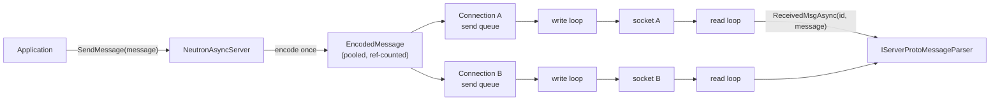
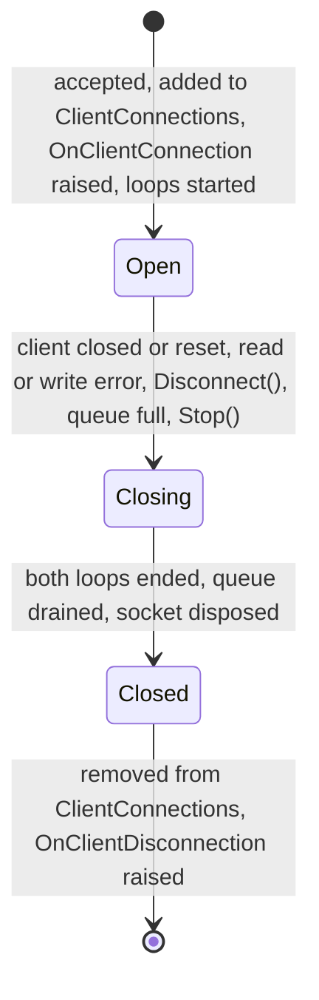
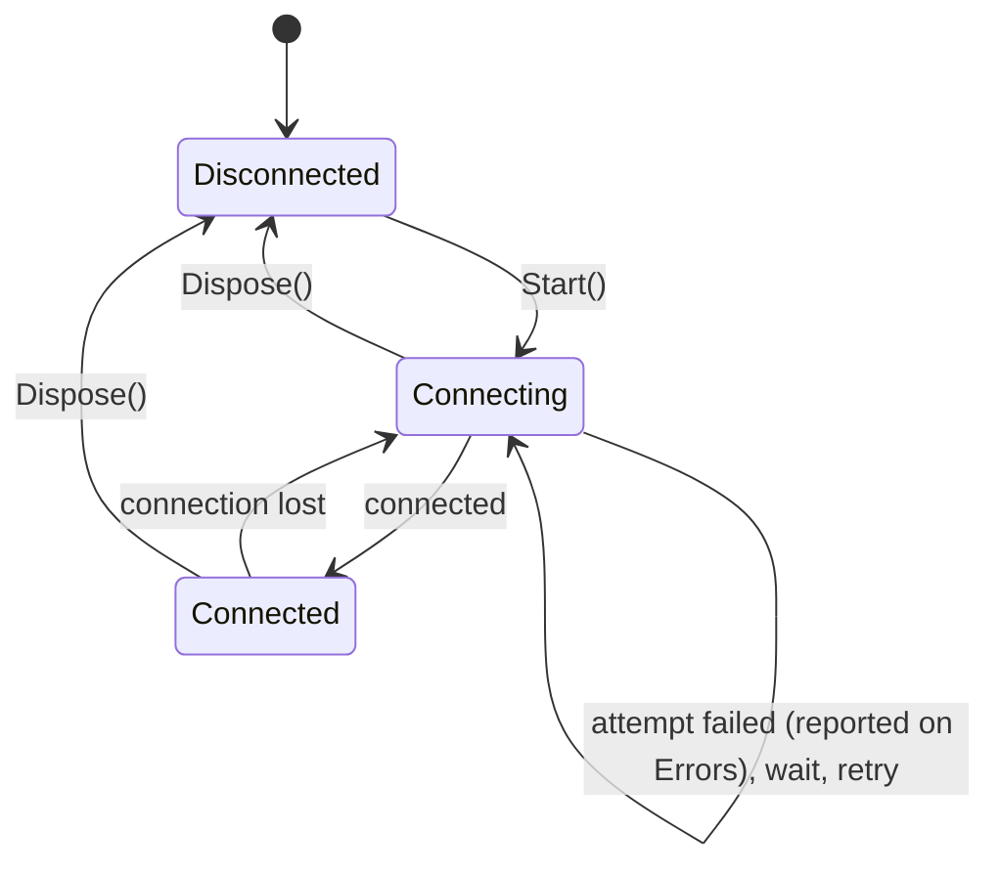

# LabLegacy.Neutron implementation

This document describes how the Neutron server and client work inside: the wire format, how messages are sent and
received, which threads run what, how connections close, and how the client reconnects. It is for engineers who
maintain the library or write a client for it. For what changed from the legacy code and why, see the
[README](../README.md).

- [Components](#components)
- [Wire format](#wire-format)
- [Sending](#sending)
- [Receiving](#receiving)
- [Threading](#threading)
- [Connection lifecycle](#connection-lifecycle)
- [Heartbeats](#heartbeats)
- [Slow clients](#slow-clients)
- [Configuration](#configuration)
- [Errors and logging](#errors-and-logging)
- [The client](#the-client)
- [Clients without the library](#clients-without-the-library)
- [Limitations](#limitations)

## Components

| Type | File | Role |
|---|---|---|
| `NeutronAsyncServer<T>` | [NeutronAsyncServer.cs](../LabLegacy.Neutron/NeutronAsyncServer.cs) | Listens, accepts clients, tracks connections by id, broadcasts, sends heartbeats, raises events. |
| `NeutronClientConnection<T>` | [NeutronClientConnection.cs](../LabLegacy.Neutron/NeutronClientConnection.cs) | One connected client, as the server sees it: its id, the slow-client rule and the disconnect event. |
| `NeutronClient<T>` | [NeutronClient.cs](../LabLegacy.Neutron/NeutronClient.cs) | The client: keeps one connection to a server, replaces it when it is lost, and reports through observables. |
| `WireConnection` | [WireConnection.cs](../LabLegacy.Neutron/WireConnection.cs) | One socket: a read loop, a bounded send queue and a write loop. Used by both the server's connections and the client, so everything under [Sending](#sending) and [Receiving](#receiving) applies to both ends. |
| `EncodedMessage` | [EncodedMessage.cs](../LabLegacy.Neutron/EncodedMessage.cs) | A message serialized once into a pooled buffer, already framed, shared between connections by reference count. |
| `IServerProtoMessageParser<T>` | [Contracts.cs](../LabLegacy.Neutron/Contracts.cs) | Implemented by the application; receives every message a client sends. |
| `NeutronServerConfig<T>` | [Contracts.cs](../LabLegacy.Neutron/Contracts.cs) | Listening address, heartbeat, queue and size limits. |

`T` is the single root message type for the server. It must be a protobuf-net contract and implement the marker
interface `IBaseMessage`.



## Wire format

The stream in each direction is a sequence of frames with nothing between them:

```
varint  length     payload size in bytes, Base128: 7 bits per byte, low bits first, top bit set on all but the last byte
bytes   payload    the message, serialized by protobuf-net
```

This is exactly what protobuf-net's `SerializeWithLengthPrefix(stream, message, PrefixStyle.Base128)` writes and
`DeserializeWithLengthPrefix<T>(stream, PrefixStyle.Base128)` reads, so the legacy clients work unchanged.

Examples of the length prefix:

| Payload size | Prefix bytes |
|---:|---|
| 0 | `00` |
| 10 | `0A` |
| 127 | `7F` |
| 128 | `80 01` |
| 300 | `AC 02` |
| 3,145,728 (3 MB) | `80 80 C0 01` |

A prefix is at most five bytes. A longer one, or a length above `MaxMessageBytes`, closes the connection.

There is no handshake, no message type tag and no version field. Both sides must agree on `T` and its protobuf
contract in advance.

## Sending

1. **Encode once.** `EncodedMessage.Create` rents a buffer from `ArrayPool` and has protobuf-net serialize straight
   into it, leaving five bytes free at the front. Once the payload size is known, the varint length is written
   right-aligned against the payload, so the frame is one contiguous block. No `MemoryStream` and no second copy are
   involved.
2. **Queue.** The frame goes into the connection's bounded `Channel<EncodedMessage>` with `TryWrite`. This never
   blocks and never touches the socket. `SendMessage` returns `true` once the message is queued.
3. **Write loop.** Each connection has one write loop, and it is the only code that writes to that socket. It takes
   everything already queued, copies the frames into one 64 KB pinned buffer and sends them with a single socket
   call. It does not wait for more messages to arrive, so a lone message goes out at once, and under load many
   messages share one system call. A frame larger than 64 KB is sent from its own buffer.
4. **Release.** After a frame is copied or sent, the connection releases its reference. The last release returns the
   buffer to the pool.

A broadcast (`SendMessage(T)`) encodes the message once and queues the same `EncodedMessage` to every connection,
adding one reference per connection. A targeted send (`SendMessage(id, message)` or `connection.SendMessage`)
encodes for that connection alone.

`TCP_NODELAY` is on, because batching is done by the write loop and the kernel has no reason to hold small writes
back.

## Receiving

Each connection's read loop reads from the socket through a `PipeReader` with a 64 KB buffer:

1. `ReadAsync` returns whatever bytes have arrived, usually many messages at once.
2. `TryReadMessage` reads a varint length from the front of the buffer. If the whole payload has arrived, it slices
   it out and moves past it. If not, it leaves the bytes in place for the next read.
3. The payload is deserialized straight from the receive buffer with `Serializer.Deserialize<T>(ReadOnlySequence<byte>)`.
4. The message is passed to `IServerProtoMessageParser<T>.ReceivedMsgAsync(connectionId, message)`, and the loop
   awaits it before reading the next message.
5. `AdvanceTo` tells the pipe which bytes were consumed. A trailing partial message is kept, and the pipe grows its
   buffer when a single message is larger than 64 KB.

Because the loop awaits the parser, messages from one client are handled in order, one at a time. A slow parser
therefore slows reading from that client only, and TCP flow control pushes back on it.

## Threading

| Code | Runs on | Guarantee |
|---|---|---|
| `SendMessage` (server or connection) | The caller's thread | Thread-safe. Never blocks and does no I/O. |
| Write loop | Thread pool, one per connection | The only writer to its socket, so frames are never interleaved. |
| Read loop and `ReceivedMsgAsync` | Thread pool, one per connection | In order and one at a time per connection. Different connections run concurrently, so a parser shared by all connections must be thread-safe. |
| Accept loop | Thread pool, one per server | |
| Heartbeat loop | Thread pool, one per server | |
| `OnClientConnection` | The accept loop | Raised before the connection starts reading. Keep handlers short. |
| `OnClientDisconnection` | The closing connection's task | Raised after the connection is removed from `ClientConnections`. |

Messages sent from one thread to one client arrive in the order they were sent. Messages sent from different threads
have no defined order relative to each other.

## Connection lifecycle



- **Id.** Each connection gets `"{guid}_{remote address}:{remote port}"`, as in the legacy code. It is the key in
  `ClientConnections` and the first argument to the parser.
- **Closing** is the same whatever triggers it:
  1. The send queue is completed.
  2. Both loops are cancelled.
  3. The socket is shut down, which also unblocks a write stuck on a client that has stopped reading.
- **After both loops end**, any unsent frames are released back to the pool and the socket is disposed.
- **Close is abrupt.** Messages still in the queue are discarded, not flushed. `Stop()` and `Dispose()` on the server
  close every connection this way.
- **`IsConnected`** is false from the moment closing starts.

## Heartbeats

If `HeartBeatMsg` is set and `HeartBeatIntervalInSec` is above zero, the server runs one `PeriodicTimer`. On each
tick it broadcasts the heartbeat like any other message: encoded once, queued to every connection.

The server does not expect heartbeats from clients, and does not close a connection for being silent. A heartbeat
that cannot be queued closes the connection through the slow-client rule below.

## Slow clients

Each connection's queue holds at most `SendQueueCapacity` messages (default 10,000). When a client stops reading:

1. Its socket's buffers fill, and the write loop's send stops completing.
2. Its queue fills.
3. The next `SendMessage` for it returns `false`, logs a warning and closes the connection.

The sender is never blocked, and the other clients are unaffected, because each has its own queue and write loop.
Memory per client is bounded by the queue capacity plus the 64 KB batch buffer.

A burst larger than the capacity, sent faster than the network can carry it, also trips this rule. Size
`SendQueueCapacity` for the largest burst a healthy client should absorb.

## Configuration

`NeutronServerConfig<T>`:

| Setting | Default | Meaning |
|---|---|---|
| `ListenerAddress` | required | Address and port to listen on. Port 0 picks a free port; `server.ListenerAddress` then shows the one bound. |
| `HeartBeatMsg` | none | Message broadcast as the heartbeat. |
| `HeartBeatIntervalInSec` | 0 (off) | Seconds between heartbeats. |
| `HandleStartException` | false | When true, a failure in `Start()` is logged and raised on `OnServerError` instead of thrown. |
| `SendQueueCapacity` | 10,000 | Messages a client may have queued before it is disconnected as too slow. |
| `MaxMessageBytes` | 16 MB | Largest message accepted from a client. |

The server constructor also sets protobuf-net's `RuntimeTypeModel.Default.IncludeDateTimeKind = true`, as the legacy
server did. This is a process-wide setting.

## Errors and logging

| Situation | What happens |
|---|---|
| `Start()` fails (port in use, for example) | Thrown, or logged and raised on `OnServerError` if `HandleStartException` is true. |
| An accept fails | Logged, raised on `OnServerError`, and the accept loop carries on. |
| A message cannot be serialized | `SendMessage` throws to the caller. Nothing is queued. |
| A read or write fails, or a length prefix is invalid | Logged as an error, and that connection closes. |
| The parser throws | Logged as a read error, and that connection closes. Catch inside the parser to keep the connection. |
| A client is too slow | Logged as a warning, and that connection closes. |
| A connection closes | Logged at information level; `OnClientDisconnection` is raised. |

All server logging goes through the `ILogger<NeutronAsyncServer<T>>` passed to the server. The client takes an
optional `ILogger<NeutronClient<T>>`; it logs each connection, each clean close by the server (information) and
each failure (warning).

## The client

`NeutronClient<T>` keeps one connection to a server and replaces it whenever it is lost. It reports through three
observables instead of events:

| Observable | What it carries | Notes |
|---|---|---|
| `Messages` | Every message from the server, in order. | Hot. Delivered on the read loop, one at a time. |
| `State` | `Disconnected`, `Connecting` or `Connected`. | Replays the current state to a new subscriber, then each change. |
| `Errors` | Why an attempt failed or a connection was lost. | The client carries on after every one. |

All three complete when the client is disposed.

```csharp
using var client = new NeutronClient<SampleMessage>(new NeutronClientConfig
{
    ServerAddress = new IPEndPoint(IPAddress.Loopback, 5080),
    HeartBeatTimeout = TimeSpan.FromSeconds(6),
});

client.Messages
    .Where(message => message.Kind == SampleMessageKind.Price)
    .Subscribe(price => Console.WriteLine(price.Price));

// Runs on every connection, the first and each reconnect.
client.State
    .Where(state => state == NeutronClientState.Connected)
    .Subscribe(_ => client.SendMessage(new SampleMessage { Kind = SampleMessageKind.Order }));

client.Start();
```

### Reconnecting

One loop runs from `Start()` until `Dispose()`:



- **Backoff.** After a failed attempt or a lost connection the client waits `ReconnectDelay` (100 ms), doubling
  after each further failure up to `MaxReconnectDelay` (5 s). A successful connection resets it. Each wait is
  varied by ±25%, so the clients of a restarted server do not all return at the same instant.
- **Connect timeout.** An attempt that takes longer than `ConnectTimeout` fails with a `TimeoutException`.
- **Nothing is replayed.** Messages either side sent while the connection was down are lost, and messages still
  in the client's send queue when the connection dropped are discarded. The server sees a reconnected client as a
  new connection with a new id. Send whatever the server needs again from a `State` subscription, as above.
- **Ordering of `Connected`.** `Connected` is published after the connection can send and before its read loop
  starts, so `SendMessage` works inside the handler and no message from that connection arrives ahead of it.

### Detecting a dead server

A server that stops or crashes closes the socket, and the client notices at once. A server that hangs, or a
network path that goes quiet, closes nothing. `HeartBeatTimeout` covers that case: when a whole interval passes
with nothing received, the connection is closed with a `TimeoutException` and replaced.

- Set it to a few times the server's `HeartBeatIntervalInSec`. Any received bytes count, not only heartbeats.
- The check compares a counter of socket reads once per interval (an `Observable.Interval`), so it costs the
  receive path nothing. Detection therefore takes between one and two times the timeout.
- It is off by default (zero).

### Sending from the client

`SendMessage` behaves as it does on the server: it serializes, queues and returns. It returns `false` when there
is no connection. If the queue is full (`SendQueueCapacity`), the server is not reading fast enough: the message
is not sent, the reason is reported on `Errors`, and the connection is replaced.

### Client threading

| Code | Runs on |
|---|---|
| `Messages` subscribers | The connection's read loop, one message at a time. A slow subscriber delays reading, and the server will drop the client once its queue for it fills. Use `ObserveOn` to move slow work elsewhere. |
| `State` and `Errors` subscribers | The client's connect loop. Keep them short. |
| `SendMessage` | The caller's thread. Thread-safe; never blocks. |

A `Messages` subscriber that throws closes the connection (reported on `Errors`), and the client reconnects. A
`State` or `Errors` subscriber that throws stops the client for good and is logged as critical.

### Client configuration

`NeutronClientConfig`:

| Setting | Default | Meaning |
|---|---|---|
| `ServerAddress` | required | An `IPEndPoint`, or a `DnsEndPoint` for a host name. |
| `ReconnectDelay` | 100 ms | Wait before the first retry; doubles after each failure. |
| `MaxReconnectDelay` | 5 s | Upper limit for that wait. |
| `ConnectTimeout` | 5 s | Longest a single connection attempt may take. |
| `HeartBeatTimeout` | 0 (off) | Silence after which the connection is treated as dead. |
| `SendQueueCapacity` | 10,000 | Messages that may be waiting to be sent. |
| `MaxMessageBytes` | 16 MB | Largest message accepted from the server. |

## Clients without the library

A client that cannot use `NeutronClient<T>` (an existing legacy client, or another platform) only needs the wire
format, which protobuf-net provides directly:

```csharp
using var tcpClient = new TcpClient { NoDelay = true };
await tcpClient.ConnectAsync(host, port);
var stream = tcpClient.GetStream();

Serializer.SerializeWithLengthPrefix(stream, message, PrefixStyle.Base128);                 // send
var received = Serializer.DeserializeWithLengthPrefix<T>(stream, PrefixStyle.Base128);     // receive; null at end of stream
```

Reads and writes can run on different threads. Writes from more than one thread must be serialized by the client,
or frames will interleave. The `LegacyClient` class in
[NeutronAsyncServerTests.cs](../LabLegacy.Neutron.Tests/NeutronAsyncServerTests.cs) is a complete example.

## Limitations

- **No TLS or authentication.** Any process that can reach the port can connect.
- **No graceful drain on close.** Queued messages are discarded when a connection closes.
- **No message-type routing.** One root type `T` per server; route inside the parser, for example on a `Kind` field.
- **No replay after a reconnect.** Whatever was sent while a client was disconnected is lost.
- **The server does not check clients for liveness.** A client that vanishes without closing is only noticed when
  the next send to it fails, or its queue fills. The client does check the server; see
  [Detecting a dead server](#detecting-a-dead-server).
- **One object allocated per message sent** (the `EncodedMessage` wrapper; its buffer is pooled), plus whatever the
  message type itself allocates when deserialized.
