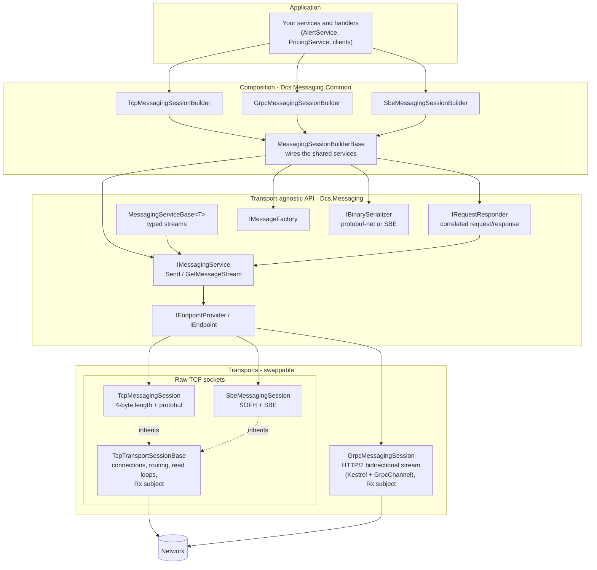
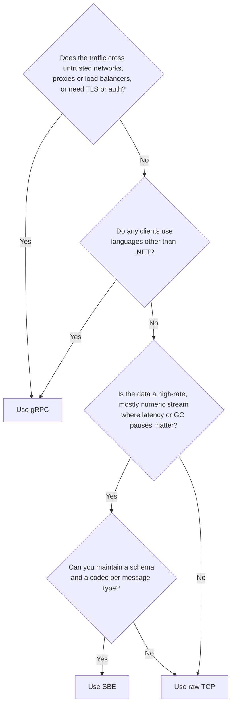

# Reactive Extensions, Transports and Serialization

This guide explains how Dcs.Messaging fits together, and covers:

- how the framework uses Reactive Extensions (Rx);
- the strengths and weaknesses of each transport (TCP, gRPC, SBE) and each serializer (protobuf-net, SBE);
- which to choose for a given job.

It is meant to be read start to finish, away from the code. File references are links you can follow later.

## Contents

- [1. How everything fits together](#1-how-everything-fits-together)
- [2. How the framework uses Reactive Extensions](#2-how-the-framework-uses-reactive-extensions)
- [3. Trade-offs of the Rx design](#3-trade-offs-of-the-rx-design)
- [4. Transports compared](#4-transports-compared)
- [5. Serialization compared](#5-serialization-compared)
- [6. Why use gRPC instead of TCP?](#6-why-use-grpc-instead-of-tcp)
- [7. When to consider SBE](#7-when-to-consider-sbe)
- [8. Use cases and how to choose](#8-use-cases-and-how-to-choose)
- [9. Quick reference](#9-quick-reference)

---

## 1. How everything fits together

### Components

Application code only deals with the builder and the services it exposes. Everything below the dotted line can be swapped by choosing a different builder.



### The two layers of encoding

Every message is encoded twice:

1. **The payload** is your DTO. `builder.Serializer` turns it into bytes.
2. **The envelope** wraps those bytes with routing information: endpoint address, sender and target session IDs, tag, and properties such as `CorrelationId` and `TimeToLiveMs`. The transport encodes the envelope.

| Builder | Payload serializer | Envelope encoding | Framing on the wire |
|---------|--------------------|-------------------|---------------------|
| `TcpMessagingSessionBuilder` | protobuf-net | protobuf `TransportEnvelope` | 4-byte big-endian length |
| `GrpcMessagingSessionBuilder` | protobuf-net | protobuf `TransportEnvelope` | gRPC message prefix inside HTTP/2 DATA frames |
| `SbeMessagingSessionBuilder` | SBE (`SbeBinarySerializer`) | SBE envelope (`SbeTransportCodec`) | Simple Open Framing Header (SOFH) |

### The life of a message, sender to receiver

```mermaid
flowchart LR
    subgraph sender [Sender]
        A["DTO"] -->|"Serializer.Serialize"| B["byte[] payload"]
        B -->|"MessageFactory.Create"| C["IMessage<br/>+ properties"]
        C -->|"MessagingService.Send<br/>returns IObservable&lt;Unit&gt;"| D["Session encodes<br/>envelope + frame"]
    end

    D -->|"bytes"| E

    subgraph receiver [Receiver]
        E["Read loop<br/>(one per connection)"] -->|"decode"| F["IncomingTransportMessage"]
        F -->|"OnNext"| G["Subject.Synchronize<br/>(one per session)"]
        G -->|"Where endpoint<br/>Where target session"| H["IObservable&lt;IMessage&gt;"]
        H -->|"Select Deserialize&lt;T&gt;"| I["IObservable&lt;T&gt;"]
        H -->|"SelectMany<br/>(RequestResponder)"| J["IObservable&lt;IRespondableRequest&gt;"]
        I --> K["Your Subscribe"]
        J --> K
    end
```



Everything on the receiving side after `OnNext` is an Rx query. The next section explains each step.

---

## 2. How the framework uses Reactive Extensions

The main idea: **messages are never pulled from anywhere. Each session pushes them into one stream, and endpoints, typed messages and request/response are all queries over that stream.**

### 2.1 One stream per session; endpoints are filtered views

Each transport session owns a single subject that all incoming traffic is pushed into ([TcpTransportSessionBase.cs:35](../Dcs.Messaging/Transport/TcpTransportSessionBase.cs#L35), [GrpcMessagingSession.cs:42](../Dcs.Messaging/Grpc/GrpcMessagingSession.cs#L42)):

```csharp
_incomingMessages = Subject.Synchronize(new Subject<IncomingTransportMessage>());
```

An endpoint is not a queue, a registration or a handler table. It is just a query over that stream ([TcpTransportSessionBase.cs:81-83](../Dcs.Messaging/Transport/TcpTransportSessionBase.cs#L81-L83)):

```csharp
_incomingMessages
    .Where(incoming => incoming.EndpointAddress == endpointDetails.Address)
    .Where(incoming => string.IsNullOrEmpty(incoming.TargetSessionId) || incoming.TargetSessionId == SessionId)
    .Select(incoming => incoming.Message);
```

What this gives you:

- **Routing is declarative.** Endpoint addressing and session targeting (broadcast or a single session) are two `Where` clauses, not branching code in the read loop.
- **No bookkeeping.** Subscribing to an endpoint costs the transport nothing, and disposing the subscription is the whole unsubscribe. The session never needs to know who is listening.
- **The transport doesn't matter at this level.** TCP, gRPC and SBE all produce the same `IObservable<IMessage>`; only the code that calls `OnNext` differs. That is why adding SBE needed no changes above the transport layer.
- **Thread safety in one line.** Each connection has its own read loop on its own thread, and they all call `OnNext`. `Subject.Synchronize` serialises those calls, so a subscriber is never called by two threads at once and handlers need no locks.
- **Clean shutdown.** Disposing the session calls `OnCompleted()`, which completes every endpoint stream in the application in one go.

### 2.2 Typed messages are a projection

`MessagingServiceBase<T>` turns the raw stream into typed objects by adding steps to the query ([MessagingServiceBase.cs:77-82](../Dcs.Messaging/Messaging/MessagingServiceBase.cs#L77-L82)):

```csharp
.Select(messageStream => messageStream.Messages
    .Select(message => message.Payload)
    .Select(_serializer.Deserialize<T>))
```

Deserialization is lazy: it runs per subscriber, and only for messages that passed the endpoint filter. It also works with any `IBinarySerializer`, which is why SBE payloads needed no changes here.

### 2.3 Request/response is a stream of requests

[TcpRequestResponder.cs:31](../Dcs.Messaging/RequestResponse/TcpRequestResponder.cs#L31) uses `SelectMany` to turn the request endpoint into an `IObservable<IRespondableRequest<TReq, TRes>>`. Each item contains the request and a `Respond` method that already knows the correlation ID and the caller's session. A server handler is just a `Subscribe`, as in `PricingService`.

Two details are worth pointing out:

- **Client-side correlation.** The sample clients ([Program.cs:68](../Dcs.Messaging.SkeletonClientApp/Program.cs#L68)) use `.Where(correlationId matches).Take(1)`. `Take(1)` unsubscribes as soon as the reply arrives, so there is no table of pending requests to clean up and nothing leaks.
- **Async operations** ([ServiceBase.cs:255](../Dcs.Messaging/ServiceModel/ServiceBase.cs#L255)):

  ```csharp
  response.Take(1).Subscribe(respondableRequest.Respond, respondableRequest.Respond);
  ```

  `Respond` has two overloads, `Respond(TResponse)` and `Respond(Exception)`. The same method name therefore works as both the `OnNext` handler and the `OnError` handler, so success and failure both go back to the caller in one line.

### 2.4 `Send` returns an observable

`Send` returns `IObservable<Unit>`, built by `ReturnAsync` on top of an `AsyncSubject` ([ObservableExtensions.cs:37](../Dcs.Messaging/Extensions/ObservableExtensions.cs#L37)). A send can therefore be:

- **fire-and-forget**, if you ignore the result (as `AlertService` does);
- **awaited**, if you need to know it completed (`await MessagingService.Send(...)`, as the SBE loopback test does);
- **combined** with other Rx operators, with a failure arriving as `OnError` instead of an exception thrown where `Send` was called.

`AsyncSubject` keeps its result, so subscribing after the send has finished still tells you whether it succeeded.

### 2.5 Lifetimes and timers are Rx too

- The sample clients manage subscriptions with `CompositeDisposable` and `SerialDisposable`. The `SerialDisposable` swaps in the new inner subscription when a stream arrives, and a single `using` block disposes everything.
- `AlertService` generates its periodic alerts with `Observable.Generate(..., i => TimeSpan.FromSeconds(1))` ([AlertService.cs:31](../Dcs.Messaging.SkeletonServerApp/Services/AlertService.cs#L31)). The timer is itself a stream, and disposing the subscription stops it.

---

## 3. Trade-offs of the Rx design

These follow from the design rather than being bugs, but you should know about them:

1. **Messages that arrive before you subscribe are lost.** The subject is hot and keeps no buffer. `GetMessageStream` also delivers its stream asynchronously, which widens the gap. That is why the samples wait on a `streamReady` event, and why the SBE test and the performance tests `await` the stream before sending anything.
2. **The order of sends is not guaranteed.** `ReturnAsync` schedules each `Send` separately on the thread pool. Two sends issued one after the other from the same thread can go out in either order. If the order of alerts or prices matters, start here.
3. **Errors from ignored sends disappear.** If nobody subscribes to the observable `Send` returns, a failure stays inside the `AsyncSubject` and is never seen.
4. **One failing subscriber can drop a connection.** If a handler throws and was subscribed without an `onError`, Rx rethrows the exception on the thread that called `OnNext`, which is that connection's read loop. The loop ends and the connection is dropped for every subscriber on it. Pass an `onError`, or guard deserialization inside your handlers.
5. **Routing cost grows with the number of subscribers.** Every endpoint subscription runs its `Where` filters on every incoming message. That is fine at this scale. With hundreds of endpoint subscriptions per session, routing through a dictionary keyed by endpoint address would scale better.

---

## 4. Transports compared

### Raw TCP (`TcpMessagingSession`)

The simplest transport: a socket, a 4-byte length prefix and a protobuf envelope.

**Advantages**

- Very few moving parts and no web host. Easy to read, debug and reason about.
- Little per-message protocol overhead: a 4-byte prefix and nothing else.
- You control the framing, so it is easy to extend. SBE reuses exactly the same socket code.
- Starts instantly and uses little memory.

**Disadvantages (in this framework)**

- **No TLS.** Traffic is plain text unless it runs inside a secure network or a tunnel.
- **Custom protocol.** A non-.NET client has to reimplement the framing and the envelope.
- **One synchronous write and flush per message**, under a per-connection lock. That is one system call per message, which limits throughput (see the benchmark below).
- **No reconnect.** The client connects once, in its constructor.
- **No flow control** beyond what TCP itself provides. A fast sender can block on a slow reader.
- Load balancers and proxies only see opaque TCP traffic.

### gRPC (`GrpcMessagingSession`)

One long-lived, bidirectional streaming call (`Exchange`) over HTTP/2. The server is hosted in Kestrel; the client uses `GrpcChannel`.

**Advantages**

- **Highest throughput in the benchmark.** Outgoing messages queue on a channel, and HTTP/2 combines many messages into each socket write.
- **A standard protocol.** It works with HTTP/2-aware load balancers, proxies, service meshes and API gateways.
- **Mature ecosystem** for cross-cutting needs: TLS and authentication via headers, deadlines and cancellation, interceptors, OpenTelemetry tracing, health checks and reflection.
- **HTTP/2 flow control** gives you backpressure per stream.
- **Clients in almost any language.** The contract is ordinary protobuf; protobuf-net can generate a `.proto` file from the code-first contract.
- **Non-blocking sends.** `Send` writes to a channel and returns at once.

**Disadvantages (in this framework)**

- **Heavier.** It needs the ASP.NET Core shared framework, Kestrel, more memory, slower startup and more dependencies (and therefore more security advisories to track).
- **More complex** to operate and debug. Errors are wrapped in HTTP/2 and gRPC status codes.
- **Cleartext HTTP/2 (h2c) by default.** TLS is not configured on the server yet.
- **Send failures are not reported back.** Writing to the channel succeeds even if the stream later fails.
- **No reconnect** if the streaming call ends.
- Each frame carries a few more bytes (5-byte gRPC prefix plus HTTP/2 framing), though batching makes this up.

### SBE (`SbeMessagingSession`)

The same socket handling as raw TCP, but with Simple Binary Encoding for the envelope and the payload, inside a standard Simple Open Framing Header.

**Advantages**

- **Smallest frames and fewest allocations** of the three in the benchmark: about 20% fewer bytes and 44% fewer allocations per message than TCP with protobuf.
- **Predictable latency.** Fixed-offset fields mean decoding is mostly direct memory reads, with little garbage-collector pressure.
- **An industry standard (FIX)** in electronic trading and market data, with standard framing (SOFH).
- **Built-in schema evolution.** Newer versions can append fields, and older readers skip them.

**Disadvantages**

- It shares raw TCP's weaknesses: no TLS, no reconnect, one synchronous write per message.
- **Schema-first.** Every payload type needs an `SbeCodec<T>`. Here the codecs are written by hand, because generating them with `sbe-tool` needs Java.
- **Poor fit for text-heavy or irregular data.** Strings and optional values cost bytes and effort.
- **Less forgiving format.** Variable-length fields must be read in order, and there is no null for variable-length data.
- **Fewer tools.** There is no equivalent of protobuf's JSON mapping or `grpcurl`, and few people know the format.

### Benchmark summary

Server-to-client push of `ForwardPricingDto` messages over loopback, Release build, 300,000 messages. See [Performance Tests](README.md#performance-tests) for how to run it.

| Transport | Messages/s | Bytes per frame | Bytes allocated per message | Gen0 GCs |
|-----------|-----------:|----------------:|----------------------------:|---------:|
| TCP + protobuf | 64,594 | 156 | 4,938 | 122 |
| gRPC + protobuf | 152,618 | 157 | 3,465 | 87 |
| SBE | 69,885 | 125 | 2,771 | 69 |

How to read the numbers:

- **SBE vs TCP** compares encoding only, because the two share the same socket code. SBE wins on size, allocations and throughput.
- **gRPC** has the highest throughput because it batches writes. The TCP and SBE throughput numbers are held back by the one-write-per-message design, not by their encoding. Batching their writes would probably move them past gRPC.

---

## 5. Serialization compared

### protobuf-net (TCP and gRPC)

**Advantages**

- **Code-first.** You add `[ProtoContract]` and `[ProtoMember(n)]` attributes, with no schema files or code generation.
- **Compact** for typical business objects: small integers use few bytes and absent fields cost nothing.
- **Forgiving schema evolution.** You can add, remove or reorder fields, as long as field numbers are never reused.
- **Works across languages.** Any protobuf library can read the format, and a `.proto` file can be generated from your classes.
- **Handles nested objects, lists, maps and nulls** naturally.

**Disadvantages**

- **Allocates on every decode** (new objects and strings), which adds garbage-collector pressure at high message rates.
- **Variable-length integers and length-prefixed nested messages** mean a field cannot be read without parsing what comes before it.
- **The framework's protobuf envelope stores property values as strings**: `TimeToLiveMs = 10000` travels as the text `"10000"` plus the type name `"int"`. That is a big reason the envelope is larger than the SBE one.

### SBE (`SbeBinarySerializer` and `SbeTransportCodec`)

**Advantages**

- **Fixed layout.** Every fixed-size field sits at a known offset, so a decoder can read only the fields it needs.
- **Native binary values.** Doubles, ints and enums are written as raw little-endian bytes, with no text conversion and no variable-length integer decoding.
- **Sized up front.** Each message is encoded into a single buffer of exactly the right size.
- **Smaller for numeric data.** `ForwardPricingDto` is a fixed 35 bytes.
- **Versioned.** Block lengths and version numbers on the wire let older readers skip fields added later.

**Disadvantages**

- **A codec per type**, written by hand here and kept in sync with the XML schema.
- **Strict field order** when writing: fixed fields first, then repeating groups, then variable-length data.
- **No null for strings.** A `null` string arrives as `""`.
- **Awkward for deep object graphs, maps, polymorphism and optional-heavy data.**
- **Can be larger than protobuf** for text-heavy messages. The framework's first SBE envelope was 299 bytes against protobuf's 256 until the layout was tuned.

---

## 6. Why use gRPC instead of TCP?

Choose **gRPC** over raw TCP when any of these apply:

1. **The traffic crosses network boundaries**: firewalls, load balancers, Kubernetes ingress, service meshes or API gateways. All of them understand HTTP/2; raw TCP with custom framing is opaque to them.
2. **Clients aren't written in .NET.** Python, Java, Go or browser (via gRPC-Web) clients can use standard gRPC libraries and a `.proto` contract instead of reimplementing your framing.
3. **You need security that is standard and audited**: TLS, mutual TLS, or tokens in metadata. The raw TCP transport has none of this today.
4. **You need operational tooling**: tracing, metrics, health checks, deadlines, retries and `grpcurl`, all of which exist off the shelf.
5. **You need high throughput without writing your own batching.** In this framework gRPC is currently the fastest transport, because HTTP/2 combines writes.
6. **You need backpressure.** HTTP/2 flow control keeps a fast producer from overwhelming a slow consumer.

Stay with **raw TCP** when:

- both ends are .NET services you control, on a trusted network, and you want the fewest dependencies;
- you are building a lightweight sidecar, test harness or embedded process where Kestrel's footprint and startup time matter;
- you want full control over the framing, for example as the base for another encoding (which is exactly how SBE is built);
- you prefer something that is easy to debug byte by byte.

---

## 7. When to consider SBE

Consider **SBE** when most of these are true:

1. **Message rates are high and latency matters**: market data, prices, order flow, telemetry or sensor feeds, where pauses for garbage collection and decode cost show up as tail latency.
2. **The messages are mostly fixed-shape numeric data**: prices, quantities, timestamps, IDs and enums, with few or short strings.
3. **You control both ends**, or you must interoperate with a venue or system that already speaks SBE. CME's market data and order-entry interfaces use SBE, for example.
4. **Bandwidth or memory per message matters**: multicast feeds, cross-region links, or very large fan-out.
5. **The schemas are stable and owned by the team**, and you are willing to maintain codecs, ideally generated with `sbe-tool` in a build step.

Avoid SBE, or limit it to the hot path, when:

- messages are mostly text, documents or deeply nested and optional data (protobuf is simpler and often smaller);
- the payload types change often or are owned by many teams;
- you need wide cross-language support without code generation, or human-friendly tools for inspecting messages;
- throughput is limited by I/O rather than encoding. Fix the I/O first (see the benchmark).

A common hybrid is to use **SBE for the high-volume data stream and protobuf or gRPC for everything else**, such as reference data, configuration, administration and request/response workflows. Because the builder decides the transport, this framework lets a single application run one session of each.

---

## 8. Use cases and how to choose

### Choosing a transport



### Example use cases

| Use case | Best fit | Why |
|----------|----------|-----|
| FX or equities price streaming between internal services | **SBE** | High rate, fixed-shape numeric data, latency- and GC-sensitive |
| Talking to an exchange or venue that publishes SBE schemas | **SBE** | Required by the counterparty, with SOFH framing to match |
| Pricing request/response from a trader UI or web back end | **gRPC** | Request/response with deadlines, auth and tracing; goes through gateways |
| Microservices running in Kubernetes behind an ingress or mesh | **gRPC** | HTTP/2 routing, mTLS, load balancing and observability |
| Clients in Python, Java or Go, or browsers via gRPC-Web | **gRPC** | Standard libraries and a `.proto` contract |
| Alerts or notifications fanned out to many subscribers | **gRPC** or **TCP** | gRPC for throughput and backpressure; TCP if both ends are internal and dependencies must be minimal |
| Internal .NET-to-.NET process pairs on one host or a trusted LAN | **TCP** | Simplest option, lightweight, quick to start |
| Test harnesses, simulators and replay tools | **TCP** | Easy to inspect and control the framing |
| Configuration, reference data and admin commands | **gRPC** or **TCP** with protobuf | Low volume, text-heavy, changes often; protobuf's flexibility pays off |
| Telemetry or sensor ingestion at very high rates | **SBE** | Compact fixed records and predictable decode cost |

---

## 9. Quick reference

| | Raw TCP | gRPC | SBE |
|---|---|---|---|
| Builder | `TcpMessagingSessionBuilder` | `GrpcMessagingSessionBuilder` | `SbeMessagingSessionBuilder` |
| Framing | 4-byte length prefix | HTTP/2 + 5-byte gRPC prefix | SOFH (6 bytes) |
| Envelope | protobuf | protobuf | SBE |
| Default payload serializer | protobuf-net | protobuf-net | SBE (a codec per type) |
| Throughput (benchmark) | Medium | Highest | Medium (encoding-bound gains limited by I/O) |
| Bytes per message | Medium | Medium | Lowest |
| Allocations per message | Highest | Medium | Lowest |
| TLS / auth in this framework | No | Not configured yet (h2c) | No |
| Works with other languages | Custom work needed | Excellent | Good, if `sbe-tool` supports the language |
| Dependencies | Minimal | ASP.NET Core / Kestrel | Minimal |
| Schema evolution | protobuf field numbers | protobuf field numbers | Block lengths and versions |
| Best for | Simple internal links | Interoperability, infrastructure, tooling | Low-latency, high-rate numeric data |

See also: [README](README.md) for setup and samples, and [ARCHITECTURE.md](ARCHITECTURE.md) for class diagrams and the byte-level wire formats.
