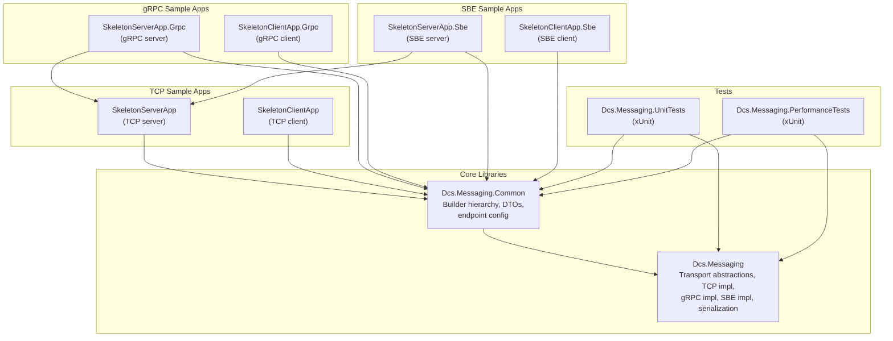

# Dcs.Messaging

Dcs.Messaging is a protocol-agnostic .NET messaging framework that supports **TCP**, **gRPC** and **SBE** (Simple Binary Encoding) transports with a unified API. Application code is written against abstractions; switching transport is a one-line builder change.

## Table of Contents

- [Solution Structure](#solution-structure)
- [Namespace Overview](#namespace-overview)
- [Architecture Overview](#architecture-overview)
- [Getting Started](#getting-started)
- [Transports](#transports)
- [Running the Samples](#running-the-samples)
- [Performance Tests](#performance-tests)
- [SBE Support: Design Notes and Known Limitations](#sbe-support-design-notes-and-known-limitations)

---

## Solution Structure



| Project | Description |
|---------|-------------|
| **Dcs.Messaging** | Core library: transport abstractions (`IMessagingService`, `IEndpoint`, `IEndpointProvider`), TCP, gRPC and SBE session implementations, protobuf and SBE serialization, the protobuf `TransportEnvelope` and SBE envelope wire formats. |
| **Dcs.Messaging.Common** | Composition root: `IMessagingSessionBuilder` interface, `MessagingSessionBuilderBase` abstract class, `TcpMessagingSessionBuilder`, `GrpcMessagingSessionBuilder`, `SbeMessagingSessionBuilder`, DTOs, SBE codecs for the DTOs, and endpoint configuration. |
| **Dcs.Messaging.SkeletonServerApp** | Sample TCP server demonstrating alerts (pub/sub) and pricing (request/response). |
| **Dcs.Messaging.SkeletonClientApp** | Sample TCP client that subscribes to alerts and requests pricing. |
| **Dcs.Messaging.SkeletonServerApp.Grpc** | Same server functionality over gRPC. Reuses the service classes from the TCP server project. |
| **Dcs.Messaging.SkeletonClientApp.Grpc** | Same client functionality over gRPC. |
| **Dcs.Messaging.SkeletonServerApp.Sbe** | Same server functionality over SBE. Reuses the service classes from the TCP server project. |
| **Dcs.Messaging.SkeletonClientApp.Sbe** | Same client functionality over SBE. |
| **Dcs.Messaging.UnitTests** | xUnit tests covering transport types, serialization (protobuf and SBE), builder wiring, and an SBE loopback round trip. |
| **Dcs.Messaging.PerformanceTests** | xUnit throughput tests: a server pumps a large volume of messages to a client over each transport, and the results are printed side by side. |

---

## Namespace Overview

| Namespace | Purpose |
|-----------|---------|
| `Dcs.Messaging` | Core public abstractions and shared message types, including `IMessagingService`, `IMessage`, `IEndpoint`, `IEndpointDetails`, `MessageFactory`, and `TransportPropertyKeys`. |
| `Dcs.Messaging.Tcp` | TCP transport sessions, endpoints, endpoint providers, and TCP session options. |
| `Dcs.Messaging.Grpc` | gRPC transport sessions, endpoint providers, service contracts, and gRPC session options. |
| `Dcs.Messaging.Sbe` | SBE transport sessions, endpoint providers, SBE session options, and the SBE building blocks (`SbeWriter`, `SbeReader`, `SbeCodec<T>`, message/group headers). |
| `Dcs.Messaging.Transport` | Wire formats shared by the transports, including `TcpTransportSessionBase`, the socket plumbing that the TCP and SBE sessions both use. |
| `Dcs.Messaging.RequestResponse` | Request/response correlation interfaces and responder implementation. |
| `Dcs.Messaging.Serialization` | Binary serializer abstractions, the protobuf-net serializer, and `SbeBinarySerializer`. |
| `Dcs.Messaging.ServiceModel` | Attribute-based service model helpers. |
| `Dcs.Messaging.Commanding` | Command stream abstractions. |
| `Dcs.Messaging.Common` | Sample composition helpers, builders, DTOs, and endpoint configuration used by the skeleton apps. |
| `Dcs.Messaging.Common.Sbe` | SBE codecs for the sample DTOs and `CommonSbeSchema.CreateSerializer()`. |

---

## Architecture Overview

See [ARCHITECTURE.md](ARCHITECTURE.md) for detailed diagrams covering:

- Builder class hierarchy
- Internal layering and message flow
- Send and receive sequences
- Request/response pattern
- Wire formats (protobuf envelope and SBE envelope)

---

## Getting Started

### Prerequisites

- .NET 10.0 SDK or later

### Building

```bash
dotnet build Dcs.Messaging.sln
```

### Running Tests

```bash
dotnet test Dcs.Messaging.sln
```

This includes the performance tests, which take around 10 seconds. To run only the unit tests:

```bash
dotnet test Dcs.Messaging.sln --filter "Category!=Performance"
```

### Quick Start (TCP)

**Server:**

```csharp
var endpointProvider = new TestEndpointDetailsProvider();
var serverId = Guid.NewGuid().ToString();
var options = TcpSessionOptions.CreateServer("127.0.0.1", 5050, serverId);
var builder = new TcpMessagingSessionBuilder("MyServer", endpointProvider, options);

using (builder.MessagingTransport)
{
    // Use builder.MessagingService to send/receive
    // Use builder.RequestResponder for request/response
    Console.ReadLine();
}
```

**Client:**

```csharp
var endpointProvider = new TestEndpointDetailsProvider();
var clientId = Guid.NewGuid().ToString();
var options = TcpSessionOptions.CreateClient("127.0.0.1", 5050, clientId);
var builder = new TcpMessagingSessionBuilder("MyClient", endpointProvider, options);

using (builder.MessagingTransport)
{
    // Use builder.MessagingService to send/receive
    Console.ReadLine();
}
```

### Quick Start (gRPC)

The only change is the builder and options type:

**Server:**

```csharp
var options = GrpcSessionOptions.CreateServer("http://127.0.0.1:5050", serverId);
var builder = new GrpcMessagingSessionBuilder("MyServer", endpointProvider, options);
```

**Client:**

```csharp
var options = GrpcSessionOptions.CreateClient("http://127.0.0.1:5050", clientId);
var builder = new GrpcMessagingSessionBuilder("MyClient", endpointProvider, options);
```

### Quick Start (SBE)

SBE runs over raw TCP sockets, so the options take a host and port like TCP:

**Server:**

```csharp
var options = SbeSessionOptions.CreateServer("127.0.0.1", 5050, serverId);
var builder = new SbeMessagingSessionBuilder("MyServer", endpointProvider, options);
```

**Client:**

```csharp
var options = SbeSessionOptions.CreateClient("127.0.0.1", 5050, clientId);
var builder = new SbeMessagingSessionBuilder("MyClient", endpointProvider, options);
```

All downstream code (`MessagingService`, `RequestResponder`, `Serializer`, etc.) is identical regardless of transport.

The one difference with SBE is `builder.Serializer`. It is an `SbeBinarySerializer`, which needs a codec for every payload type. By default it knows the sample DTOs. For your own types, see [Using SBE with your own payload types](#using-sbe-with-your-own-payload-types).

---

## Transports

### TCP

- Uses raw TCP sockets with a **4-byte big-endian length prefix** followed by protobuf-serialized `TransportEnvelope` bytes.
- Server binds to `host:port` and accepts multiple client connections.
- Client connects to a single server endpoint.
- Configure via `TcpSessionOptions.CreateServer(host, port, sessionId)` / `TcpSessionOptions.CreateClient(host, port, sessionId)`.

### gRPC

- Uses **protobuf-net.Grpc** (code-first) with a single **bidirectional streaming** RPC (`Exchange`).
- Server runs an embedded **Kestrel** HTTP/2 host via `WebApplication`.
- Client connects via `GrpcChannel.ForAddress`.
- For local development without TLS, HTTP/2 cleartext (h2c) is enabled by default (`EnableHttp2Unencrypted = true` on options).
- Configure via `GrpcSessionOptions.CreateServer(baseUrl, sessionId)` / `GrpcSessionOptions.CreateClient(baseUrl, sessionId)`.

### SBE (Simple Binary Encoding)

- Implements the [FIX Simple Binary Encoding](https://www.fixtrading.org/standards/sbe/) standard: little-endian, fixed-offset fields, repeating groups and variable-length data.
- Each frame starts with a **Simple Open Framing Header** (SOFH): a 4-byte big-endian frame length and the 2-byte encoding type `0x5BE0`. An SBE `TransportEnvelope` message follows. See [ARCHITECTURE.md](ARCHITECTURE.md#sbe-envelope) for the layout.
- Uses SBE for both layers: the transport envelope and, through `SbeBinarySerializer`, the application payload. Message properties travel as native binary values rather than strings.
- Server and client socket handling is shared with the TCP transport (`TcpTransportSessionBase`), so the two differ only in encoding.
- The schemas are in `Dcs.Messaging/Sbe/Schemas/dcs-messaging-transport.xml` and `Dcs.Messaging.Common/Sbe/dcs-messaging-common.xml`. The codecs are written by hand to match them, so the solution does not need Java or `sbe-tool`. If you change a schema, update its codec too.
- Configure via `SbeSessionOptions.CreateServer(host, port, sessionId)` / `SbeSessionOptions.CreateClient(host, port, sessionId)`.

#### Using SBE with your own payload types

SBE is schema-first, so there is no reflection-based fallback. Write an `SbeCodec<T>` for each payload type:

```csharp
public sealed class QuoteDtoSbeCodec : SbeCodec<QuoteDto>
{
    // Fixed block: double price (8) + int32 quantity (4)
    public QuoteDtoSbeCodec() : base(schemaId: 100, templateId: 1, blockLength: 12) { }

    protected override int GetVariableDataLength(QuoteDto value) => SbeWriter.GetVarStringLength(value.Venue);

    protected override void Encode(QuoteDto value, ref SbeWriter writer)
    {
        writer.WriteDouble(value.Price);   // fixed block fields first, in schema order
        writer.WriteInt32(value.Quantity);
        writer.WriteVarString(value.Venue); // then variable-length data
    }

    protected override QuoteDto Decode(ref SbeReader reader, ushort actingVersion)
    {
        var dto = new QuoteDto { Price = reader.ReadDouble(), Quantity = reader.ReadInt32() };
        reader.EndBlock();                  // skips block fields appended by newer schema versions
        dto.Venue = reader.ReadVarString();
        return dto;
    }
}

var serializer = new SbeBinarySerializer(new QuoteDtoSbeCodec(), new ForwardPricingDtoSbeCodec());
var builder = new SbeMessagingSessionBuilder("MyServer", endpointProvider, options, serializer);
```

SBE has no null for variable-length data, so a `null` string is decoded as `""`. A fixed-length `char` array that is all null bytes is decoded as `null`.

---

## Running the Samples

### TCP pair

In two separate terminals:

```bash
# Terminal 1 - Server
dotnet run --project Dcs.Messaging.SkeletonServerApp

# Terminal 2 - Client
dotnet run --project Dcs.Messaging.SkeletonClientApp
```

### gRPC pair

```bash
# Terminal 1 - Server
dotnet run --project Dcs.Messaging.SkeletonServerApp.Grpc

# Terminal 2 - Client
dotnet run --project Dcs.Messaging.SkeletonClientApp.Grpc
```

### SBE pair

```bash
# Terminal 1 - Server
dotnet run --project Dcs.Messaging.SkeletonServerApp.Sbe

# Terminal 2 - Client
dotnet run --project Dcs.Messaging.SkeletonClientApp.Sbe
```

> **Note:** All three sample pairs default to port 5050, so run only one server at a time. A client only works with a server of the same transport.

---

## Performance Tests

`Dcs.Messaging.PerformanceTests` measures server-to-client throughput for each transport. For each transport, the test:

1. Starts a server and a client in the same process, connected over loopback.
2. Does a handshake, then sends a warm-up burst that is not timed (10,000 messages by default).
3. Has the server send a large volume of `ForwardPricingDto` price updates (100,000 by default) through the public `IMessagingService.Send` API.
4. Stops the clock when the client has received and deserialized the last one.

Each transport uses its builder's default serializer: protobuf-net for TCP and gRPC, SBE for SBE. The comparison therefore covers the whole stack, not only the encoding.

| Test | What it runs |
|------|--------------|
| `Tcp_ServerPumpsProtobufMessagesToClient` | TCP + protobuf envelope + protobuf payload |
| `Grpc_ServerPumpsProtobufMessagesToClient` | gRPC bidirectional stream + protobuf |
| `Sbe_ServerPumpsSbeMessagesToClient` | SBE over TCP + SBE payload |
| `AllTransports_SideBySideComparison` | All three in sequence, printed as one table |

Run them in Release with detailed output so you can see the results:

```bash
dotnet test Dcs.Messaging.PerformanceTests -c Release --logger "console;verbosity=detailed"

# Only the side-by-side table, with a larger volume
DCS_PERF_MESSAGES=300000 dotnet test Dcs.Messaging.PerformanceTests -c Release --filter "FullyQualifiedName~AllTransports" --logger "console;verbosity=detailed"
```

| Environment variable | Default | Meaning |
|----------------------|---------|---------|
| `DCS_PERF_MESSAGES` | 100000 | Timed messages per transport |
| `DCS_PERF_WARMUP` | 10000 | Untimed warm-up messages per transport |

Each test reports:

- **Msg/s**: messages received per second.
- **Wire MB/s**: throughput in bytes on the wire.
- **Payload B**: serialized DTO size.
- **Frame B**: bytes per message on the wire. For gRPC this is the envelope plus the 5-byte gRPC prefix; HTTP/2 frame headers are not included.
- **Alloc B/msg**: managed bytes allocated per message, for both server and client.
- **Gen0 GCs**: gen-0 garbage collections during the timed run.

The tests only assert that every message arrived. Absolute numbers depend on the machine.

Example run (Release, 300,000 messages, Windows 11, loopback):

| Transport | Msg/s | Frame B | Alloc B/msg | Gen0 GCs |
|-----------|------:|--------:|------------:|---------:|
| TCP       | 64,594 | 156 | 4,938 | 122 |
| gRPC      | 152,618 | 157 | 3,465 | 87 |
| SBE       | 69,885 | 125 | 2,771 | 69 |

How to read these numbers:

- **SBE vs TCP** isolates the encoding, because the two share the same socket code. SBE frames are about 20% smaller and allocate about 44% less per message, and throughput is a little higher.
- **gRPC** has the highest throughput here. It queues outgoing messages on a channel, and HTTP/2 combines many messages into each socket write. The TCP and SBE sessions write and flush each frame synchronously, so they make one system call per message. Per-message I/O, not encoding, limits those two transports. Batching their writes would be the next optimization (see [Possible next step](#possible-next-step-batched-socket-writes)).

---

## SBE Support: Design Notes and Known Limitations

### What SBE refers to

SBE here means **Simple Binary Encoding**, the FIX Trading Community standard for low-latency binary messages. It is not a general "sequential binary" format. The implementation follows the SBE specification: a standard message header, fixed-offset little-endian fields, repeating groups, variable-length data, and Simple Open Framing Header (SOFH) framing over TCP.

### Design decisions

- **SBE end to end.** `SbeMessagingSessionBuilder` encodes the transport envelope with SBE (`SbeTransportCodec`) and also uses SBE for the application payload (`SbeBinarySerializer`). The TCP and gRPC builders keep protobuf-net for both.
- **Shared socket code with TCP.** The socket handling (accepting connections, connecting, routing by session ID, the per-connection read loop) lives in `TcpTransportSessionBase`. `TcpMessagingSession` and `SbeMessagingSession` both derive from it and only supply frame encoding and decoding. As a result, the TCP and SBE performance numbers differ only because of encoding. Behaviour of the TCP transport is unchanged.
- **Codecs written by hand.** Java and `sbe-tool` are not available in this environment, so the codecs are written by hand against the XML schemas in `Dcs.Messaging/Sbe/Schemas/` and `Dcs.Messaging.Common/Sbe/`. If you change a schema, update the matching codec.
- **Envelope layout tuned for size.** The first version of the envelope stored every message property in a 14-byte entry and used 4-byte length prefixes for all strings. Its frames were *larger* than protobuf's (299 vs 256 bytes for a typical response), so the layout was revised:
  - `TimeToLiveMs` and `IsPersistent`, which `MessageFactory` sets on every message, became fixed root-block fields that use SBE null values when absent.
  - Other properties use a 9-byte entry: a `double` value plus a `kind` byte. Every int32 fits exactly in a double.
  - Strings use a 2-byte length prefix. Payloads keep a 4-byte length prefix.

  The same typical response is now 219 bytes (vs 256 for protobuf). A unit test checks that SBE stays smaller.
- **Forward compatible.** Decoders use the block lengths on the wire, so a newer schema version can append fields and older readers will skip them. A unit test covers this.

### Known limitations

- **Every payload type needs a codec.** SBE is schema-first, so there is no reflection fallback. Serializing a type with no registered `SbeCodec<T>` throws `NotSupportedException`. See [Using SBE with your own payload types](#using-sbe-with-your-own-payload-types).
- **Null strings become empty.** SBE has no null for variable-length data, so a `null` string field is decoded as `""`. Fixed-length `char` arrays that are all null bytes are decoded as `null`.
- **Size limits.** A string field can hold at most 65,534 UTF-8 bytes, and a message can have at most 65,535 properties. Currency codes in the sample DTOs are fixed at 3 ASCII characters; a longer code throws `ArgumentException`.
- **`dotnet test` includes the performance tests.** They add about 10 seconds to a solution-wide test run. Use `--filter "Category!=Performance"` to skip them.
- **Log output when gRPC shuts down.** When a gRPC test or sample shuts down, Kestrel logs `System.IO.IOException: The client reset the request stream.` This is expected during disposal, comes from the existing gRPC transport, and does not indicate a failure.

### Possible next step: batched socket writes

The TCP and SBE transports currently write and flush each frame synchronously under a per-connection lock. Queuing frames per connection and having a single writer that flushes in batches would likely close most of the throughput gap with gRPC. This has not been done because it changes the semantics of `Send`: errors such as a dropped connection would no longer surface from the `IObservable` returned by `Send`. The gRPC transport already behaves this way.

### Test coverage

| Area | Tests |
|------|-------|
| `SbeMessagingSessionBuilder` wiring | `Builders/SbeMessagingSessionBuilderTests` |
| Envelope encoding: SOFH, header, typed properties, fixed fields, malformed input, size vs protobuf | `Sbe/SbeTransportCodecTests` |
| DTO codecs: round trips, fixed sizes, null handling, unknown types, schema evolution | `Sbe/SbeBinarySerializerTests` |
| Request and targeted response between a server and a client over loopback | `Sbe/SbeMessagingSessionTests` |
| Throughput of TCP, gRPC and SBE | `Dcs.Messaging.PerformanceTests` |
